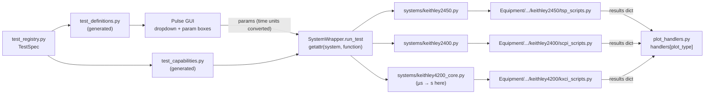

# Adding a pulse test

A pulse test is defined in **one place**: a `TestSpec` entry in `Pulse_Testing/test_registry.py`.
That entry controls which systems list the test, its dropdown label and order, its parameters, which
plot is drawn, and how the GUI runs it. `test_capabilities.py` and `test_definitions.py` are generated
from the registry — do not edit their tables.

After any change, run:

```
py -m pytest Pulse_Testing/tests -q
```

It calls every test on every system it claims (2450, 2450 Sim, 2400/2401, 4200 PMU, 4200 SMU) with the
GUI's default parameters and fails if a script would raise `TypeError`, silently ignore a parameter,
or is only a `NotImplementedError` stub.

## How a test runs



The optical tests (`runner="optical"` / `"optical_sweep"`) go through `gui/pulse_testing_gui/optical_runner.py`
instead of `SystemWrapper`, because they synchronise the laser with SMU reads.

## Worked example: "Double Pulse → Read" on 2450, 2400 and 4200 PMU

### 1. Register it

Add a `TestSpec` to `TESTS` in `test_registry.py`. List position = dropdown position.

```python
TestSpec(
    function="double_pulse_read",
    display_name="Double Pulse → Read",
    systems=SMU_24XX | PMU_4200,        # 2450 + 2450 Sim + 2400/2401 + 4200 PMU
    plot_type="time_series",
    description="Pattern: Initial Read → (Pulse → Pulse → Read) × N",
    params={
        "pulse_voltage": {"default": 1.5, "label": "Pulse Voltage (V)", "type": "float"},
        "pulse_width": {"default": 1.0, "label": "Pulse Width", "type": "float"},
        "read_voltage": {"default": 0.2, "label": "Read Voltage (V)", "type": "float"},
        "num_cycles": {"default": 10, "label": "Cycles", "type": "int"},
        "delay_between": {"default": 1.0, "label": "Delay Between", "type": "float"},
        "clim": {"default": 0.001, "label": "Current Limit (A)", "type": "float"},
        "read_width": {"default": 2.0, "label": "Read Width (µs) [4200A only]",
                       "type": "float", "4200a_only": True},
    },
),
```

System groups: `SMU_2450`, `SMU_2400`, `SMU_24XX` (both), `PMU_4200`, `SMU_4200`. If the 2450 simulator
cannot run it yet, add the function to `SIM_2450_NOT_PORTED`.

Parameter keys: `default`, `label`, `type` (`float | int | bool | str | list | choice`) are required.
Optional flags:

| Flag | Meaning |
|------|---------|
| `4200a_only` | Only shown on PMU systems; entered in µs |
| `gui_only` | Display option (e.g. plot axis); never sent to the instrument |
| `choices` | Allowed values for `type="choice"` |

### 2. Implement it on each system

Add a default to `systems/base_system.py` so unsupported systems fail clearly:

```python
def double_pulse_read(self, **params) -> Dict[str, Any]:
    raise NotImplementedError(f"double_pulse_read not supported on {self.get_system_name()}")
```

2450 and 2400 adapters are pass-throughs to the instrument scripts:

```python
def double_pulse_read(self, **params) -> Dict[str, Any]:
    if not self.test_scripts:
        raise RuntimeError("Not connected to device")
    return self.test_scripts.double_pulse_read(**params)
```

The 4200 adapter (`keithley4200_core.py`, once for PMU and SMU) converts the GUI's µs to seconds:

```python
def double_pulse_read(self, **params) -> Dict[str, Any]:
    if not self._scripts:
        raise RuntimeError("Not connected")
    for key in ("pulse_width", "delay_between", "read_width"):
        if key in params:
            params[key] = params[key] / 1_000_000.0  # µs → s
    return self._scripts.double_pulse_read(**params)
```

Then write the script method on each `Equipment/...` scripts class. **Name every GUI parameter
explicitly in the signature** — do not add `**kwargs`. A catch-all hides typos and settings the user
thinks are applied; the registry test reports any parameter that only lands in `**kwargs`.

### 3. Return the standard result

```python
{
    "timestamps":  [...],   # seconds from start, one per point
    "voltages":    [...],
    "currents":    [...],
    "resistances": [...],
    # optional, same length: "phase", "operation", "pulse_types", "cycle_number", ...
}
```

Use the scripts' `_format_results(...)` helper. `plot_handlers.py` reads the optional columns, and
`gui.last_results["test_function"]` holds your `function` name if a plot needs test-specific handling
(branch on that, not on the display name, which may be renamed).

### 4. Plot

Pick an existing `plot_type` (see `handlers` in `gui/pulse_testing_gui/plot_handlers.py`). For a new
plot, add `"my_plot": _plot_my_plot` to that dict and implement `_plot_my_plot(gui)`.

### 5. Optional behaviour flags on `TestSpec`

| Field | Use |
|-------|-----|
| `progress=True` | GUI passes `progress_callback(partial_results)` for live plotting |
| `runner="optical"` / `"optical_sweep"` | Laser-synchronised test run by `optical_runner.py` (add the function there too) |
| `hidden=True` | Runnable from code but not listed in the dropdown |

## Units — the rule that causes most bugs

| System | GUI sends time params in | Script receives |
|--------|--------------------------|-----------------|
| 2450, 2400/2401 | seconds (unit selector converted) | seconds |
| 4200 PMU | **µs** | seconds — `keithley4200_core.py` divides by 1e6 |
| 4200 SMU | seconds | seconds |

Convert **once**, in the 4200 adapter. A KXCI script must not convert again (Electrical Pulse Train
used to divide twice, turning 100 µs into 0.1 ns). The time parameter names are `TIME_PARAMS` and the
PMU edge/read-window names are `PMU_EDGE_PARAMS` in `test_registry.py`; add a new time parameter there.

## Checklist

- [ ] `TestSpec` added to `TESTS` with the right `systems`
- [ ] Default in `base_system.py`; adapter method on each listed system
- [ ] Script method on each instrument with every GUI parameter named (no `**kwargs`)
- [ ] 4200: µs → s in `keithley4200_core.py` only
- [ ] Returns `timestamps / voltages / currents / resistances`
- [ ] `py -m pytest Pulse_Testing/tests -q` passes
- [ ] Tried once on the bench per instrument
