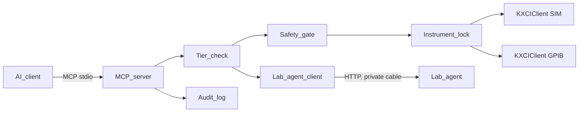

# 04 — MCP server (main PC)

The MCP server is the only way the AI touches the simulator, the build
machinery or the instrument. It runs on the main PC, written in Python with
the official MCP SDK (FastMCP). Safety rules: [00_safety.md](00_safety.md).

## Placement



- Transport to the AI client: stdio only. The server does not listen on any
  network port.
- The server is the only process on the main PC that holds the GPIB
  connection while V2 is in use.

## Suggested layout (future code)

```text
v2/
  mcp_server/
    server.py            tool definitions
    gate.py              EX parsing and envelope checks
    modules/             one parser + limit table per registered module
    lab_agent_client.py  HTTP client for the lab agent
    audit.py
  config.toml            envelope, addresses, timeouts (human-edited only)
```

## Tools by tier

| Tier | Tool | Purpose |
|---|---|---|
| 0 | `get_status()` | Tiers, lock owner, interlock state, last build, KXCI health |
| 0 | `sim_run_ex(command)` | Run an `EX` against `KXCIClient("SIM...")` |
| 0 | `sim_query_gp(param, count)` | Read simulator `GP` data |
| 0 | `c_precheck(lib, files)` | Local syntax and header checks ([05](05_build_pipeline.md)) |
| 0 | `gate_check(command)` | Dry-run the safety gate on an `EX` string |
| 1 | `deploy_and_build(lib, files)` | Deploy to `V2_*`, build, restart KXCI, health check |
| 1 | `fixture_check()` | Run the interlock ([06](06_validation_fixture.md)) |
| 1 | `hw_run_ex(command)` | Gated `EX` on the instrument |
| 1 | `hw_query_gp(param, count)` | `GP` readback after a successful `hw_run_ex` |
| 1 | `validate_resistor(module, params)` | Run and score against 10 kOhm ([06](06_validation_fixture.md)) |
| any | `hw_abort()` | `DE`, device clear, outputs to 0 V, release lock |
| any | `hw_kill_switch()` | Abort plus stop the lab agent; drop to tier 0 |
| 2 | `remote_shell(...)` | See [03](03_remote_control.md) |
| 3 | `remote_screenshot()` and friends | See [03](03_remote_control.md) |

There is no tool for editing `config.toml`, enabling tiers, clearing the
interlock or approving a first run. Those are human actions.

## Safety gate

For each `EX <Library> <module>(args)`:

1. **Parse** library, module and the comma-separated argument list (empty
   slots are output arrays, as in the existing builders).
2. **Library check:** `V2_*` libraries are allowed; `A_Check_Connection` is
   allowed only with the fixed interlock parameters; anything else is
   rejected.
3. **Module registry:** each allowed module has an entry in
   `mcp_server/modules/` that names each argument and its limit. Modules
   without an entry are rejected. The AI can propose a registry entry in a
   pull request, but a human must merge it.
4. **Envelope:** check every voltage, current, width, point count and
   I-range against [00_safety.md](00_safety.md). For PMU modules also
   estimate segment count and burst duration ([07](07_pmu.md)).
5. **First-run approval:** if this module build hash has never run on
   hardware, ask the human to approve in the MCP client.
6. **Interlock:** the fixture check must have passed since the last
   build/restart.
7. On any failure, return a structured error (which argument, value, limit)
   and send nothing to the instrument.

## Instrument lock and timeouts

- A single lock covers `hw_run_ex`, `hw_query_gp`, `fixture_check` and
  `deploy_and_build`.
- Timeouts come from `config.toml` (defaults in
  [00_safety.md](00_safety.md)). A timeout triggers `hw_abort`.
- If the AI client disconnects while holding the lock, the server runs
  `hw_abort` and releases it.

## SIM and hardware separation

- Simulator tools always use an address starting with `SIM`; hardware tools
  always use the configured GPIB address.
- Hardware tools refuse a `SIM*` address, and simulator tools refuse a
  non-`SIM` address. This prevents a simulator test from reaching the
  instrument by mistake, and a hardware result from coming from the
  simulator.

## Configuration (`v2/config.toml`)

```toml
[instrument]
gpib_address = "GPIB0::17::INSTR"
sim_address = "SIM4200"

[lab_agent]
url = "http://192.168.50.2:8765"
token_env = "V2_LAB_AGENT_TOKEN"   # value never stored in the repo

[envelope.smu]
v_max = 1.0
i_limit_max = 200e-6
points_max = 200
run_s_max = 30

[envelope.pmu]
v_max = 1.0
i_ranges_allowed = [10e-6, 100e-6, 1e-3]
i_limit_max = 1e-3
width_min_s = 1e-6
max_points_max = 30000
segments_max = 350
burst_s_max = 10

[fixture]
r_nominal = 10000
r_tol_interlock = 0.05
r_tol_smu = 0.02
r_tol_pmu = 0.05

[timeouts]
smu_ex_s = 60
pmu_ex_s = 120
build_s = 300

[tiers]
tier1_enabled = false
approval_expiry_min = 120
```

## Audit

Every tool call writes one JSON line with timestamp, tool, tier, arguments
(token values removed), gate decision, result summary and duration. Hardware
`GP` arrays are stored next to the log so any result can be re-checked later.

## Testing the server itself

- Unit tests for every module parser and envelope rule, using strings just
  inside and just outside each limit.
- End-to-end tests with the simulator only.
- A test that hardware tools refuse `SIM*` addresses and the reverse.
- No test in CI ever opens GPIB.
