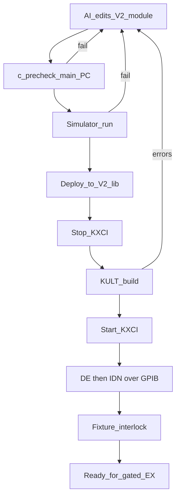

# 05 — Build pipeline

How a C module goes from the AI's edit to a library loaded on the 4200 and
ready for a gated run. Safety rules: [00_safety.md](00_safety.md).



## 1. `c_precheck` (main PC, tier 0)

Catches most mistakes in seconds, without touching the 4200.

### Syntax check

- Run `gcc -fsyntax-only -Wall` on each `.c` file.
- Use stub headers in `v2/c_stubs/`:
  - `keithley.h`: prototypes for the LPT and PMU calls the repo's modules use
    (for example `getinstid`, `pmu_*`, `rpm_config`, `seg_arb_sequence`,
    `seg_arb_waveform`, `forcev`, `measi`, `limiti`, `devint`), and the
    constants they need (`KI_RPM_PATHWAY`, `KI_RPM_PULSE`, and so on). Build
    the list from the `.c` files in
    [`C_Code_with_python_scripts/`](../Equipment/SMU_AND_PMU/4200A/C_Code_with_python_scripts/)
    and the LPT manual in `Equipment/manuals/`.
  - `nvm.h` only if a module needs it.
- The stubs only need to be close enough for a syntax and type check. The real
  KULT build is still the final word.

### USRLIB header check

Clarius rejects modules whose `USRLIB MODULE INFORMATION` block is
incomplete (see
[`README_BURST_TEST.md`](../Equipment/SMU_AND_PMU/4200A/C_Code_with_python_scripts/pmu_endurance_interleaved/README_BURST_TEST.md)).
The precheck parses the block and verifies:

- `MODULE NAME` matches the C function name and is unique across all
  libraries (check against the names used in this repo).
- `NUMBER OF PARMS` equals the number of `ARGUMENTS:` rows and the number of
  function parameters.
- Each row's type (`double`, `int`, `char *`, `D_ARRAY_T`, `I_ARRAY_T`)
  matches the C parameter type, in the same order.
- No `#include <Windows.h>` in `INCLUDES` (known clash noted in
  `pmu_ttl_laser_ch1/README.md`).
- Min/max columns for voltage and current inputs are within the V2 envelope
  (for example `-1, 1` for voltages). Clarius may enforce these in its UI;
  do not assume KXCI does, which is why the constants below exist as well.

### Safety-constant check

Every `V2_*` module must start its function body with the shared block from
`v2/c_template/v2_limits.h`, for example:

```c
#define V2_V_MAX        1.0
#define V2_I_LIMIT_MAX  1e-3
#define V2_WIDTH_MIN    1e-6
#define V2_MAX_POINTS   30000
```

and must return a dedicated error code (for example `-900`) if any input is
outside those limits, before calling any instrument function. The precheck
verifies the block is present and unchanged (hash compare). The lab agent's
`/deploy` repeats the check.

## 2. Simulator run (tier 0)

- SMU modules: use the existing `Simulation4200` paths, extended per module
  as needed.
- PMU modules: need the new PMU handler described in [07_pmu.md](07_pmu.md).
- The Python runner for the module must pass against the simulator, including
  at least one fault-injection case (`Simulation4200Faults`: timeout,
  truncated `GP`, error code).

## 3. Deploy (tier 1)

- `POST /deploy` to the lab agent with library `V2_<Name>` and the files.
- The agent keeps the previous version in `history\<timestamp>\`.

## 4. Build (tier 1)

Order, with the instrument lock held:

1. `DE` over GPIB.
2. `/kxci/stop`.
3. `/build`:
   - **Preferred:** KULT command-line build, if this Clarius version has one.
     Must be confirmed on the instrument (phase 2 in
     [08_rollout_checklist.md](08_rollout_checklist.md)).
   - **Fallback:** drive the KULT window through tier 3
     ([03_remote_control.md](03_remote_control.md)) with a recorded sequence.
4. `/kxci/start`.
5. Health check from the main PC: connect over GPIB, `DE`, `*IDN?`.
6. Fixture interlock ([06_validation_fixture.md](06_validation_fixture.md)).

If any step fails: `hw_abort`, report the failed step, leave the lock
released and the previous library version available for rollback.

## 5. Build log parsing

The lab agent returns:

```json
{
  "ok": false,
  "method": "kult-cli",
  "errors": [{"file": "v2_readtrain.c", "line": 214, "message": "undeclared identifier 'measV'"}],
  "warnings": [],
  "raw_log_tail": "..."
}
```

The parser recognises at least compiler errors and warnings, linker errors
such as `multiple definition of` (a file added twice, as noted in
`pmu_endurance_interleaved/README.md`), and Clarius header-parse errors
("parsing parameter").

## 6. Rollback

`deploy_and_build(lib, rollback_to=<timestamp>)` restores a previous version
from `history\` and rebuilds through the same sequence.

## What the AI cannot do here

- Build or deploy anything outside `V2_*`.
- Skip the precheck, the health check or the interlock.
- Remove or change the safety-constant block (the hash check fails).
