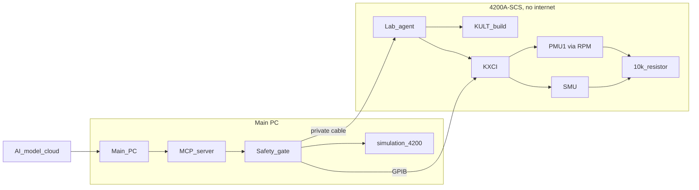

# V2: AI-driven remote build and test for the 4200A-SCS

## Goal

Let an AI on the main PC take a measurement task, write C USRLIB modules,
build them on the 4200A-SCS, run them against a known 10 kOhm resistor with
the SMU and the PMU, and iterate until the results are right. The 4200 never
gets internet access, and the AI cannot damage the instrument, Windows, or the
existing user libraries.

V2 is a **separate, opt-in system**. The existing Switchbox_GUI app and the
[`AGENTS.md`](../AGENTS.md) rule "Never touch real hardware" stay unchanged for
normal work. Hardware access in V2 only happens through the safety gate in
[00_safety.md](00_safety.md).

These documents are plans. No V2 code exists yet.

## Architecture

The AI model always runs in the cloud and is reached only from the main PC.
Nothing AI-related runs on the 4200 except, optionally, Cursor's remote
server component (see [09_remote_ssh_option.md](09_remote_ssh_option.md)).

## Two ways for the AI to act on the 4200

| | A. Custom lab agent (default plan) | B. Cursor Remote-SSH (option) |
|---|---|---|
| How | Small Python HTTP service on the 4200 with fixed endpoints | Cursor on the main PC opens the 4200's files and terminal over SSH |
| What the AI can do | Exactly the allowlisted actions | Anything the Windows account allows |
| Screen/GUI control | Yes (tier 3 endpoints) | No |
| Effort | Medium (write and maintain the agent) | Small, but offline install is unproven |
| Docs | [02](02_lab_agent_4200.md), [03](03_remote_control.md) | [09](09_remote_ssh_option.md) |

In both models, **every instrument command (`EX`) still goes through the MCP
server's safety gate** over GPIB from the main PC. The two models can run
side by side: B for editing code and running builds, A for screen control and
fixed build/restart actions.

## AI iteration loop

1. Write or modify a C module in a `V2_*` library only.
2. `c_precheck` on the main PC: syntax, USRLIB header and safety constants.
3. Run the Python side against the simulator.
4. Deploy and build on the 4200; on failure, read the parsed build log and go to 1.
5. Fixture interlock passes (10 kOhm present).
6. `validate_resistor` on the SMU or PMU path.
7. Pass: commit. Fail: inspect raw `GP` arrays and go to 1.

## What we reuse from this repo

| Existing piece | Role in V2 |
|---|---|
| [`kxci_scripts.py`](../Equipment/SMU_AND_PMU/keithley4200/kxci_scripts.py) `KXCIClient` | `UL` / `EX` / `GP` / `DE` over GPIB; `SIM*` addresses route to the simulator |
| `build_retention_ex_command`, `build_interleaved_ex_command`, `build_endurance_ex_command` | Reference EX builders and parameter order |
| `PMU_DISCRETE_I_RANGES`, `analyze_pmu_i_range_usage`, `estimate_*_seg_arb_segments`, `_PMU_EX_ERROR_HINTS` | PMU range checks, burst size estimates, error explanations |
| [`simulation_4200.py`](../Equipment/SMU_AND_PMU/keithley4200/simulation_4200.py) | Inner loop for SMU modules (`smu_ivsweep`, `SMU_pulse_measure`, `SMU_pulse_only`, bias-timed read) with fault injection |
| [`connection_check_runner.py`](../Equipment/SMU_AND_PMU/4200A/C_Code_with_python_scripts/Single_Point_Bias/connection_check_runner.py) (`A_Check_Connection smu_check_connection`) | Basis for the fixture interlock check |
| C modules in [`C_Code_with_python_scripts/`](../Equipment/SMU_AND_PMU/4200A/C_Code_with_python_scripts/) | Templates for `V2_*` copies; dual-channel PMU architecture |

### Gap: no PMU simulation yet

`simulation_4200.py` does not simulate any PMU module
(`readtrain_dual_channel`, `pmu_retention_dual_channel`,
`pmu_pulse_read_interleaved`, `pmu_endurance_interleaved`). Adding a PMU `EX`
handler that models a pure resistor is a **prerequisite** for PMU work. See
[07_pmu.md](07_pmu.md).

## Document index

| Doc | Contents |
|---|---|
| [00_safety.md](00_safety.md) | **Read first.** Tiers, SMU/PMU envelope, fixture interlock, approvals, backups, kill switch |
| [01_network_link.md](01_network_link.md) | Direct cable, static IPs, firewall; the 4200 never gets internet |
| [02_lab_agent_4200.md](02_lab_agent_4200.md) | Offline Python install, tier-1 endpoints, autostart |
| [03_remote_control.md](03_remote_control.md) | Tier 2 shell and tier 3 screen control (off by default) |
| [04_mcp_server.md](04_mcp_server.md) | MCP tools by tier, safety gate, config |
| [05_build_pipeline.md](05_build_pipeline.md) | Precheck, simulator, deploy, KULT build, KXCI restart |
| [06_validation_fixture.md](06_validation_fixture.md) | 10 kOhm wiring for SMU and PMU, pass/fail criteria |
| [07_pmu.md](07_pmu.md) | PMU/RPM specifics, limits, PMU simulator, porting order |
| [08_rollout_checklist.md](08_rollout_checklist.md) | Phased go-live and open questions to check on the 4200 |
| [09_remote_ssh_option.md](09_remote_ssh_option.md) | Cursor Remote-SSH as an alternative access model |

## Non-goals

- Giving the 4200 any route to the lab LAN or the internet.
- Letting the AI edit, rebuild or delete any library not named `V2_*`.
- Running an AI model on the 4200.
- Changing Switchbox_GUI measurement behaviour.
